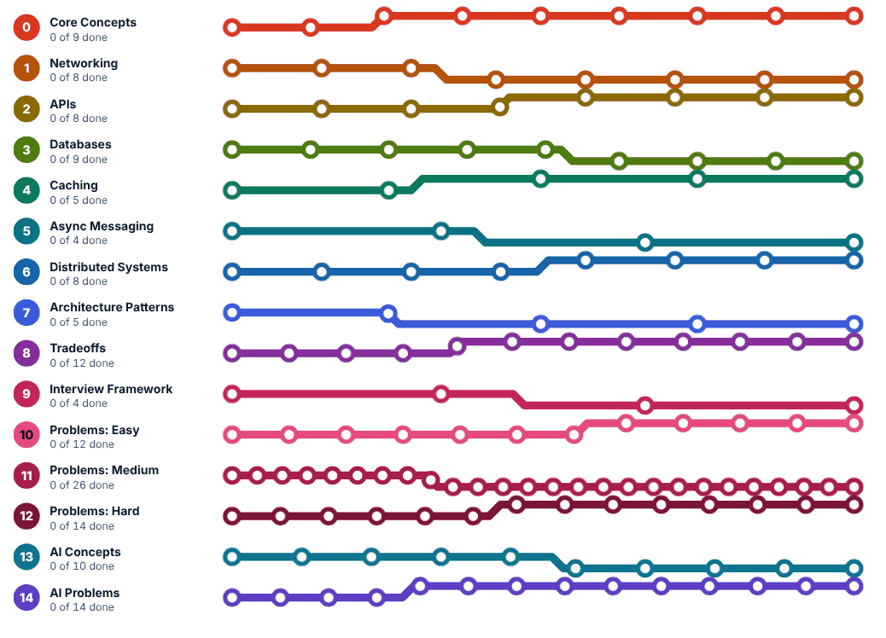

<div align="center">

# sysDesign101

**Learn system design by riding the route: 15 lines, 148 stations, one interactive demo at every stop.**

[](https://tanmayhc7.github.io/SystemDesign101/)
[](https://tanmayhc7.github.io/SystemDesign101/#/p/0)
[](https://tanmayhc7.github.io/SystemDesign101/#/p/10)


<a href="https://tanmayhc7.github.io/SystemDesign101/"></a>

</div>

## The route

| | Line | Stations | Highlights |
|:-:|---|:-:|---|
|  | [Core Concepts](https://tanmayhc7.github.io/SystemDesign101/#/p/0) | 9 | Scalability, availability, CAP, consistent hashing |
|  | [Networking](https://tanmayhc7.github.io/SystemDesign101/#/p/1) | 8 | DNS, HTTP/HTTPS, TCP vs UDP, load balancing |
|  | [APIs](https://tanmayhc7.github.io/SystemDesign101/#/p/2) | 8 | Gateways, REST vs GraphQL, idempotency, rate limiting |
|  | [Databases](https://tanmayhc7.github.io/SystemDesign101/#/p/3) | 9 | ACID, indexes, sharding, replication, Bloom filters |
|  | [Caching](https://tanmayhc7.github.io/SystemDesign101/#/p/4) | 5 | Strategies, eviction, distributed caches, CDNs |
|  | [Async Messaging](https://tanmayhc7.github.io/SystemDesign101/#/p/5) | 4 | Pub/sub, queues, Kafka-style logs, CDC and the outbox |
|  | [Distributed Systems](https://tanmayhc7.github.io/SystemDesign101/#/p/6) | 8 | Consensus, locking, gossip, circuit breakers, tracing |
|  | [Architecture Patterns](https://tanmayhc7.github.io/SystemDesign101/#/p/7) | 5 | Microservices, serverless, sagas, CQRS, P2P |
|  | [Tradeoffs](https://tanmayhc7.github.io/SystemDesign101/#/p/8) | 12 | Strong vs eventual, push vs pull, batch vs stream |
|  | [Interview Framework](https://tanmayhc7.github.io/SystemDesign101/#/p/9) | 4 | Six-step answer, estimation calculator, zero to millions |
|  | [Problems: Easy](https://tanmayhc7.github.io/SystemDesign101/#/p/10) | 12 | URL shortener, KV store, authentication, UPI |
|  | [Problems: Medium](https://tanmayhc7.github.io/SystemDesign101/#/p/11) | 26 | WhatsApp, Instagram, rate limiter, payments, Kafka |
|  | [Problems: Hard](https://tanmayhc7.github.io/SystemDesign101/#/p/12) | 14 | Uber, Google Docs, Zoom, S3, a stock exchange |
|  | [AI System Design](https://tanmayhc7.github.io/SystemDesign101/#/p/13) | 10 | LLM inference, batching, RAG, vector search, agents, guardrails, evals |
|  | [AI Interview Problems](https://tanmayhc7.github.io/SystemDesign101/#/p/14) | 14 | Enterprise RAG, support and code review agents, inference serving, voice |

## At every station

- **Play with it.** An interactive demo: crash a replica, trigger a retry storm, shard a table, or build an architecture by picking components.
- **Go deeper.** A short lesson, an in-depth section, key terms, and prerequisites.
- **Check yourself.** A two-question quiz, plus a six-question quiz at the end of each line.
- **Prepare for interviews.** Questions at Mid, Senior, and Staff+ levels, with what a strong answer covers and the usual pitfalls.

Every interview problem follows the same route: **clarify** with question cards, **estimate** with sliders, **build** the architecture, then **deep dive** into the hard parts.

Progress, XP, and streaks stay in your browser. Export or import them from the [Progress page](https://tanmayhc7.github.io/SystemDesign101/#/about).

## Run locally

```sh
python3 -m http.server --bind 127.0.0.1 8000   # open http://127.0.0.1:8000
python3 build.py                               # rebuild index.html after editing src/
```

<details>
<summary><b>Project structure and adding a lesson</b></summary>

| Path | Purpose |
| --- | --- |
| [`src/`](src/) | Lesson data, demos, routing, quizzes, and styles |
| [`build.py`](build.py) | Combines the sources and topic data into one static page |
| [`index.html`](index.html) | The generated page served by GitHub Pages |
| [`repo.json`](repo.json), [`parse_repo.py`](parse_repo.py) | Topic catalog and the script that generates it |

Register a demo in `src/demosN.js`, then call `lesson(phaseIndex, definition)` in the course data. Match the lesson `key` to the upstream topic title so its source link and video are found. Use `ctx.every` for recurring timers so they stop when the learner leaves. Rebuild `index.html` afterwards.

</details>

## Credits

An independent companion to [Awesome System Design Resources](https://github.com/ashishps1/awesome-system-design-resources). Demo numbers are illustrative. Licensed under the [GNU GPL v3](LICENSE).
